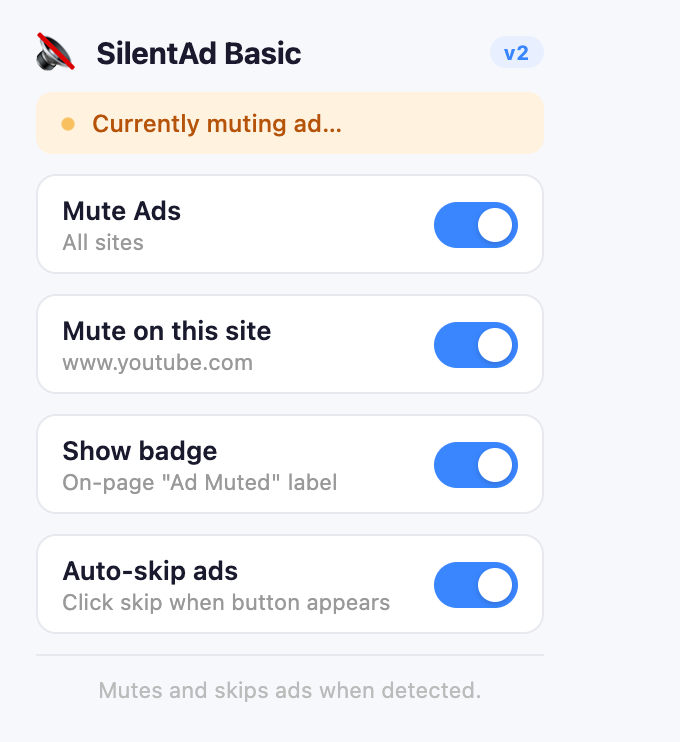
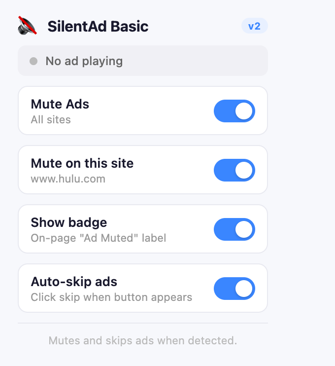

# 🔇 SilentAd

**Ads still play. You just don't have to hear them.**

*A lightweight Chrome extension that mutes video ads the moment they start on YouTube, Hulu, Peacock and other HTML5 players, then brings your sound back the instant they end.*

&nbsp;&nbsp;&nbsp;&nbsp;

---

## Why SilentAd?

Ad blockers break sites and get you banned from streaming services. SilentAd takes a gentler route: it **never blocks** an ad, it just turns the volume down while it runs. Creators still get paid, sites keep working, and you stop wincing at sudden loud commercials.

## Features

- **Instant mute, instant restore.** Mutes both the video element *and* the tab when an ad starts, then restores your previous audio state when it ends.
- **Works where you watch.** YouTube pre-roll and mid-roll ads, Hulu, Peacock, plus a generic HTML5 detector for other video sites.
- **Two detection layers.** It reads the player's own ad markers in the page, and on YouTube it also listens for ad-network (VAST) requests, so ads are caught even when the page markup changes.
- **Optional auto-skip.** When the site shows its own **Skip** button, SilentAd can press it for you. You can turn this off.
- **Live status.** The popup shows *"Currently muting ad…"* in real time for the current tab.
- **Your rules.** A global on/off switch, a per-site toggle, and an optional on-page **"Ad Muted"** badge.

## Install (developer mode)

1. Download or clone this repo.
2. Open `chrome://extensions` and turn on **Developer mode**.
3. Click **Load unpacked** and select the project folder.
4. Pin 🔇 SilentAd, play a video, and enjoy the quiet.

## How it works

| File | Role |
|---|---|
| `manifest.json` | MV3 manifest: permissions, host matches and content scripts |
| `content.js` | Detects ads in the page (YouTube, Hulu, Peacock, generic), mutes the video, shows the badge, and handles auto-skip |
| `injected.js` | Runs in the page context and intercepts `fetch`/XHR to spot ad-network requests on YouTube |
| `background.js` | Service worker that mutes and unmutes the whole tab via `chrome.tabs` |
| `popup.html/css/js` | Settings and live status UI, saved with `chrome.storage` |

## Privacy

Everything runs locally in your browser. There are no servers, no analytics and no tracking. Settings are stored in `chrome.storage.local`.

## About

Built by **Roszhan Raj**.
